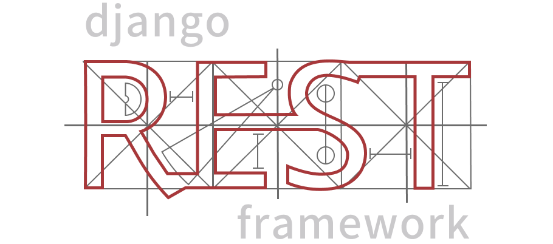
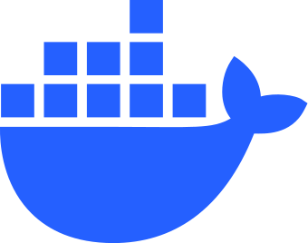

# Core Django Apps

Core Application containing many of the common django apps pre-built production grade. Gives a common application to start a new project not from scratch but from a pre-built prodcution ready setting. The core is meant to be used as a sub-module in your project, just use the app as a submodule in you'r project and configure you'r project taking reference from sample_project.

## Tech Stack

<p align="center">
  
  
  
  
  
  
</p>

---

| Component          | Technologies                                                          |
| :----------------- | :-------------------------------------------------------------------- |
| **Backend**        | django (5.2), django-rest-framework, django-tenants, django-constance |
| **Frontend**       | Vue 3 (Composition API), Vite, Vuetify 3, Pinia                       |
| **Worker/Queue**   | Celery, Valkey                                                        |
| **Database**       | PostgreSQL                                                            |
| **Infrastructure** | Docker, Compose, Poetry, Pre-Commit                                   |

## Core Directory Structure

```
core-django-apps/
|	|- .agents/ 			# Common agentic configs, skills, plugins
|	|- .vscode/				# IDE settings for vscode
|	|- .github/				# Core Github Workflows, Actions and settings
|	|- apps/				  # Core apps, swappable apps comes pre-installed in core
|	|- config/				# Django Configurations
|	|- scripts/				# Core Common scripts shipped by core
|	|- tests/				  # Core Common tests shipped by core
|	|- utils/				  # Core Common utils shipped by core
| |- sample_project/      # A sample project shipped with core, easy to copy-paste the CI/CD and other setups in a new project
|	|- .gitignore
|	|- .dockerignore
|	|- .env.example
|	|- .pre-commit-config.yaml
```

## Sample Project Directory Structure

This directory struture is supposed to be followed by any inheriting sub-project that used this core as a submodule.

```
core-django-apps/
|	|- .vscode/				# IDE settings for vscode
|	|- apps/				# Sample apps core inherits/overrides or new apps
|   |- compose/             # Compose configuration for sample_project, can be copied as-it-is in any project
```

### Reason behind the directory structure

This structure is designed to leverage **Docker BuildKit's** context isolation:

- During the backend build, only the `backend/` directory is provided as context.
- During the frontend build, only the `frontend/` directory is provided as context.

This eliminates accidental leakage of irrelevant code (e.g., frontend source in the backend image) and ensures that changes in one domain do not unnecessarily invalidate the build cache of the other.
This also gives us future scope of easily splitting backend from frontend.

## Local Development Setup

### Makefile hierarchy

### Quick Start Local Setup

```bash
make build 		# Builds the entire project image(S)
make run 		# Run (Build Conatiners) from built image(s) attached
```

---

## Core Architecture Guidelines & App Design Standards

This repository follows a strict modular design pattern to ensure swappability, multi-tenant isolation, and clean separation of concerns across consuming projects.

### 1. Models (`models_abstract.py` & `models.py`)

- **Architecture in 1–2 Lines**: Abstract models (`models_abstract.py`) define all fields, managers, clean methods, and business logic. Concrete models (`models.py`) subclass abstract models, add no new fields, and declare swappability (`swappable = "APP_MODEL_KEY"`).
- **How to Work with Models**:
  - **Never Import Concrete Models Directly**: Do not do `from core.apps.<app>.models import <Model>`. Direct imports bypass Django's swappable model mechanism and break custom overrides provided by consuming projects.
  - **Dynamic Model Getters**: Always export and use getter functions in the app's root `__init__.py` (e.g. `get_user_model()`, `get_customer_model()`) backed by `django.apps.apps.get_model(settings.<APP>_<MODEL>_MODEL, require_ready=False)`.
  - **Resolve at Module Level**: Assign `Model = get_<model>_model()` once at module top level in serializers, views, and services. Avoid calling `get_<model>_model()` repeatedly inside method loops.
  - **Static Type Safety**: Use `if typing.TYPE_CHECKING:` to import abstract classes (e.g. `from .models_abstract import AbstractUser`) for type annotations without runtime circular dependencies.
  - **Foreign Keys**: Always reference models via settings strings (e.g., `to=settings.AUTH_USER_MODEL`), never concrete classes.
  - **Single Concrete Table per Entity**: Multi-Table Inheritance (MTI) is strictly prohibited. Use discriminator fields and abstract mixins instead.

### 2. App Settings (`app_settings.py` & `__init__.py`)

- **Architecture in 1–2 Lines**: App settings declare descriptor-based static defaults (`Settings`), live admin flags (`Constance`), and versioned JSON (`Configuration`) on an app-specific `BaseSettings` class, instantiated as a shared singleton in the app's root `__init__.py`.
- **How to Work with App Settings**:
  - **Never Instantiate inside `app_settings.py`**: Define only `class <App>Settings(BaseSettings):` in `app_settings.py`. Instantiate `app_settings = <App>Settings()` inside `core/apps/<app>/__init__.py`.
  - **Descriptor Lifecycle Awareness**: In Python (PEP 487), descriptor `__init__` runs during class body execution, before `__set_name__` is called. Descriptors initialize `name` and `app_settings_key` safely and never assume `app_settings_key` is present during early `validate()` calls.
  - **Deferred Imports**: Descriptors handling deferred model imports (`SettingsType.DEFFERED_IMPORT`) safely tolerate `AppRegistryNotReady` during Django's app population phase.
  - **Zero Heavy Dependencies**: Default adapter backends and descriptors prefer Python's standard library (e.g., `http.client`) over heavy optional packages.

### 3. Views & Serializers (`api/views.py`, `api/serializers.py`)

- **Architecture in 1–2 Lines**: Views act as lightweight HTTP request orchestrators delegating business logic to managers and services; serializers validate request schemas and format output data using dynamically resolved models.
- **How to Work with Views & Serializers**:
  - **No Lazy Inline Imports**: Keep imports clean at module level. Avoid inline `from ... import ...` inside method bodies.
  - **Module-Level Model Resolution**: Resolve models once at the top of serializers and views using `get_<model>_model()`.
  - **Type Annotations**: Annotate parameters with quoted type names backed by `if typing.TYPE_CHECKING:` imports.
  - **Explicit Serializer Fields**: Always declare explicit `fields` and `read_only_fields` lists. Never use `fields = "__all__"` on mutable entities.
  - **Asynchronous View Invariants**: Return `202 Accepted` immediately for asynchronous dispatches (such as OTP dispatch) without leaking user existence.
  - **No Synchronous External Calls or Network I/O in Request Thread**: Never execute network calls, third-party APIs (such as SMS or email delivery), heavy computations, or schema migrations in the main HTTP request thread. All external delivery calls must be delegated to background worker tasks (`queue_task()`). If queuing a background task encounters an error, log the failure; never fall back to executing blocking external calls synchronously in the request-response thread.

### 4. URLs & Routers (`urls.py`)

- **Architecture in 1–2 Lines**: Modular app routing registers ViewSets on environment-aware DRF routers configured via `get_api_router_instance()`.
- **How to Work with URLs**:
  - Always register endpoints using `get_api_router_instance()` (`SimpleRouter` in production, `DefaultRouter` in development).
  - Use kebab-case plural resource paths with explicit `basename` definitions (e.g., `router.register("users", UserViewSet, basename="users")`).

### 5. Pre-Commit Quality & Hook Verification

- Always run pre-commit hooks post-changes and ensure all checks pass cleanly before committing:
  ```bash
  poetry run pre-commit run --all-files
  ```
- Ensures consistent Black formatting, isort import ordering, and flake8 compliance across the codebase.
