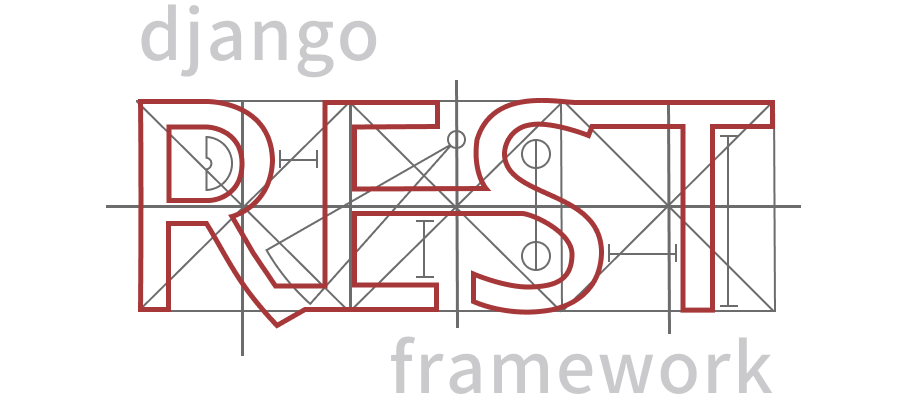
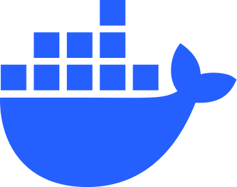

# core-apps-django

A production-ready Django core framework for multi-tenant SaaS backends. Instead of starting each project from scratch, add this repo as a **git submodule** and inherit a tested foundation: schema-per-tenant multi-tenancy, swappable users and auth, CRM, invoicing, versioned configuration, integration adapters, seeders and Celery plumbing.

Your project keeps ownership of its settings, its migrations and any model overrides. `sample_project/` is the reference to copy from.

<p align="center">
  
  
  
  
  
</p>

## What you get

| App | Schema | Provides |
| :-- | :-- | :-- |
| [`tenants`](core/apps/tenants/Readme.md) | public | tenants, domains, branding, async schema provisioning |
| [`users`](core/apps/users/Readme.md) | public + tenant | accounts, OTP (email/SMS), lockout, JWT, Google login |
| [`configurations`](core/apps/configurations/Readme.md) | tenant | versioned JSON settings validated by JSONSchema |
| [`crm`](core/apps/crm/Readme.md) | tenant | customers, contacts, addresses, KYC documents, OCR pipeline |
| [`invoices`](core/apps/invoices/Readme.md) | tenant | billing organizations, parties, invoices, items, fees |
| [`integrations`](core/apps/integrations/Readme.md) | tenant | provider credentials; email, SMS and payment adapters |

Shared building blocks live in `core/libraries/` (seeder, and others as they move in) and `core/utils/` (base models, soft delete, versioning, error handling, routers, `queue_task`).

## Tech stack

| Component | Technologies |
| :-- | :-- |
| Backend | Django 5.2, Django REST Framework, django-tenants, django-constance |
| Worker / queue | Celery, Valkey |
| Database | PostgreSQL |
| Tooling | Docker, Compose, Poetry, pre-commit, pytest |

Exact versions: `pyproject.toml` and `poetry.lock`.

## Use it in a new project

1. Add this repo as a submodule of your project.
2. Copy the starting points from `sample_project/` (settings, `compose/`, `.env.example`, pre-commit config) and adapt them.
3. Point `MIGRATION_MODULES` at your own `db_migrations/` folder. Core apps ship models, not migrations.
4. Substitute any model by overriding its swappable setting key (for example `CRM_CUSTOMER_MODEL`) in your settings.
5. Run `make setup`.

Single-tenant projects can opt out of tenancy with the override in `core/config/settings/single_tenant.py`.

## Repository layout

```
core/
  apps/         swappable domain apps (tenants, users, configurations, crm, invoices, integrations)
  libraries/    reusable libraries (seeder today; more moving in)
  utils/        cross-cutting helpers (models, error handling, routers, tasks)
  config/       base settings, Celery and logging config
  templates/    Jinja2 UI (see core/templates/Readme.md)
  tests/        shared test setup and tests
  seeder/       legacy seeder, being migrated to core/libraries/seeder
scripts/        make recipes (common.mk) and agent/skill link scripts
sample_project/ reference host project (compose files, settings, db_migrations)
docs/           working notes for AI agents (not user documentation)
.agents/        agent skills
```

## Local development

Everything runs in Docker through `make`. Targets are defined in `scripts/common.mk`.

```bash
make setup        # build, migrate, seed tenants and dev data (first run)
make clean-setup  # DESTROYS the dev database volume, then setup again
make run          # start containers in the foreground
make rund         # start containers in the background
```

| Task | Command |
| :-- | :-- |
| Run tests | `make t`, `make t TEST_DIR=<path>`, `make tf TEST_FILTER=<expr>` |
| Make / apply migrations | `make mm APP_LABEL=<app>`, `make m` (public), `make ms` (all tenants) |
| Seed dev data | `make seed-tenants`, `make seed-models` |
| Shell | `make s`, `make sp` (shell_plus), `make ts SCHEMA=<name>` (tenant shell) |
| New app | `make start-app APP_LABEL=<name>` |
| Link skills into a host project | `make link-skills` |

### Back up before you change data

```bash
make db-dump            # logical dump (pg_dump)
make db-volume-dump     # cold snapshot of the Postgres volume
make db-restore BACKUP_FILE=<file>
```

Destructive targets: `db-destroy`, `clean`, `clean-setup`, `db-delete`, `db-restore`, `db-volume-restore`. Take a dump first.

## Architecture in brief

- **Swappable models.** Abstract models hold the logic (`models_abstract.py`); concrete models are thin subclasses declared `swappable`. Resolve models with the app's `get_<model>_model()` getters, never by importing the concrete class.
- **App settings.** Each app declares typed settings, live admin flags and versioned JSON configuration through descriptors in `app_settings.py`. See `core/utils/app_settings/Readme.md`.
- **Async work.** Background jobs go through `queue_task()`, which defers dispatch until commit and carries the tenant schema to the worker.
- **Tenancy.** Public apps live in the shared schema and tenant apps in each tenant schema. Schemas are provisioned asynchronously, never on the request thread.

Each module's `Readme.md` documents its models, settings and public API.

## Contributing

- Read [`AGENTS.md`](AGENTS.md). It is the source of truth for conventions and workflow, for people and AI agents alike.
- Run `poetry run pre-commit run --all-files` before committing. All hooks must pass.
- Add tests with your change and run them through `make t`.
- Keep the Readme of any module you change accurate.
