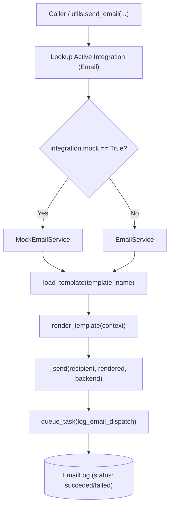

# Analysis: Integrations App Architecture (`core.apps.integrations`)

## 1. Overview & Architecture

The `integrations` app is a modular, multi-tenant Django application designed to manage, configure, and use multiple third-party services (Email, SMS, Payments, etc.) uniformly across tenants.

### Directory Structure & Layout
```
core/apps/integrations/
├── __init__.py                     # Exports app_settings, get_integration_model(), get_credentials_manager_model()
├── apps.py                         # AppConfig (name="core.apps.integrations", label="integrations")
├── app_settings.py                 # IntegrationsSettings(BaseSettings)
├── constants.py                    # IntegrationKeyChoices, CredentialsNameChoices
├── models_abstract.py              # AbstractIntegration, AbstractCredentialsManager
├── models.py                       # Concrete swappable models: Integration, CredentialsManager
├── admin.py                        # Admin registration on private_admin_site
├── utils.py                        # Unified facade functions: send_email(), send_sms()
├── email/                          # Sub-app / feature-app (label="integrations_email")
│   ├── __init__.py                 # Exports app_settings, dynamic getters, get_email_service
│   ├── apps.py                     # AppConfig (name="core.apps.integrations.email", label="integrations_email")
│   ├── app_settings.py             # IntegrationsEmailSettings(BaseSettings)
│   ├── constants.py                # EmailLogStatus, EmailTemplateInterfaceType
│   ├── models_abstract.py          # AbstractEmailLog (BaseLogModel), AbstractEmailTemplate (BaseTemplateModel)
│   ├── models.py                   # Swappable models: EmailLog, EmailTemplate
│   ├── admin.py                    # Admin registration on private_admin_site
│   ├── tasks.py                    # Celery tasks: log_email_dispatch, send_email_async
│   └── service/
│       ├── __init__.py             # Exports get_email_service() getter
│       ├── base.py                 # BaseEmailService (load_template, render_template, send, _send)
│       ├── mock.py                 # MockEmailService (used when integration.mock=True)
│       └── email.py                # EmailService (production backend integration)
├── sms/                            # Sub-app / feature-app (label="integrations_sms")
│   ├── __init__.py                 # Exports app_settings, dynamic getters, get_sms_service
│   ├── apps.py                     # AppConfig (name="core.apps.integrations.sms", label="integrations_sms")
│   ├── app_settings.py             # IntegrationsSMSSettings(BaseSettings)
│   ├── constants.py                # SMSLogStatus, SMSTemplateInterfaceType
│   ├── models_abstract.py          # AbstractSMSLog (BaseLogModel), AbstractSMSTemplate (BaseTemplateModel)
│   ├── models.py                   # Swappable models: SMSLog, SMSTemplate
│   ├── admin.py                    # Admin registration on private_admin_site
│   ├── tasks.py                    # Celery tasks: log_sms_dispatch, send_sms_async
│   └── service/
│       ├── __init__.py             # Exports get_sms_service() getter
│       ├── base.py                 # BaseSMSService (load_template, render_template, send, _send)
│       ├── mock.py                 # MockSMSService (used when integration.mock=True)
│       └── sms.py                  # SMSService (production backend integration)
└── payments/                       # Sub-app / feature-app (label="integrations_payments")
    ├── __init__.py                 # Exports app_settings, dynamic getters, get_payment_service
    ├── apps.py                     # AppConfig (name="core.apps.integrations.payments", label="integrations_payments")
    ├── app_settings.py             # IntegrationsPaymentsSettings(BaseSettings)
    ├── constants.py                # PaymentGatewayChoices, PaymentStatusChoices
    ├── models_abstract.py          # AbstractPaymentLog (BaseLogModel), AbstractPaymentTransaction
    ├── models.py                   # Swappable models: PaymentLog, PaymentTransaction
    ├── admin.py                    # Admin registration on private_admin_site
    ├── tasks.py                    # Celery tasks: log_payment_dispatch
    └── service/
        ├── __init__.py             # Exports get_payment_service() getter
        ├── base.py                 # BasePaymentService
        ├── mock.py                 # MockPaymentService (used when integration.mock=True)
        └── payment.py              # PaymentService

core/backends/                      # Pluggable delivery backends
├── email/
│   ├── __init__.py
│   └── console.py                  # CoreConsoleEmailBackend (logging email messages)
├── sms/
│   ├── __init__.py
│   ├── base.py                     # BaseSMSBackend(abc.ABC)
│   └── console.py                  # ConsoleSMSBackend(BaseSMSBackend)
└── payment/
    ├── __init__.py
    ├── base.py                     # BasePaymentBackend(abc.ABC)
    └── console.py                  # ConsolePaymentBackend
```

---

## 2. Model Specifications

### Top-Level Integrations App (`integrations`)
1. **`CredentialsManager`**:
   - Inherits: `BaseModel` (`UUIDModel`, `TimeStampedModel`, `SoftDeletableModel`).
   - Fields:
     - `name`: `CharField(choices=CredentialsNameChoices.choices, max_length=64)` (e.g. `SENDGRID`, `TWILIO`, `AWS_SES`, `STRIPE`).
     - `details`: `models.JSONField(default=dict, blank=True)` (Standard JSONField now; designed for drop-in replacement with `EncryptedJSONField` using Fernet/AES in future scope).
     - `file`: `models.FileField(upload_to="integrations/credentials/", null=True, blank=True)` (e.g. Google service account JSON, Apple APNs .p8 keys).
     - `expires_on`: `models.DateTimeField(null=True, blank=True)` (tracks API key or certificate expiry).

2. **`Integration`**:
   - Inherits: `BaseModel`.
   - Fields:
     - `integration_key`: `CharField(choices=IntegrationKeyChoices.choices, max_length=64)` (`EMAIL`, `SMS`, `PAYMENT`, etc.).
     - `label`: `CharField(max_length=128)` (e.g. "Primary Twilio Account", "Company SendGrid").
     - `is_active`: `BooleanField(default=True)` (whether service is globally or tenant-enabled).
     - `has_webhooks`: `BooleanField(default=False)` (signals webhook ingress support).
     - `credentials`: `models.ForeignKey(to=settings.INTEGRATIONS_CREDENTIALS_MANAGER_MODEL, on_delete=models.SET_NULL, null=True, blank=True, related_name="integrations")`.
     - `mock`: `BooleanField(default=False)` (routes execution to `MockEmailService` / `MockSMSService` when `True`).

### Sub-Apps Models (`email`, `sms`, `payments`)
1. **`EmailLog`**:
   - Inherits: `BaseLogModel` (`UUIDModel`, `TimeStampedModel`, `StatusModel` with `STATUS`, `message_type`, `message`, `traceback`).
   - Additional fields:
     - `recipient`: `CharField(max_length=255)`.
     - `subject`: `CharField(max_length=255)`.
     - `template_used`: `models.ForeignKey(to=settings.INTEGRATIONS_EMAIL_EMAIL_TEMPLATE_MODEL, null=True, blank=True, on_delete=models.SET_NULL)`.
     - `context_data`: `JSONField(default=dict, blank=True)`.
     - `backend_used`: `CharField(max_length=128, blank=True)`.

2. **`EmailTemplate`**:
   - Inherits: `BaseTemplateModel` (`BaseSemanticVersionModel` with `interface_type`, `plain_content`, `html_content`, `template_mapping`, `render_template()`).
   - `subject`: `CharField(max_length=255)`.

3. **`SMSLog`**:
   - Inherits: `BaseLogModel`.
   - Additional fields:
     - `recipient`: `CharField(max_length=64)` (phone number).
     - `template_used`: `models.ForeignKey(to=settings.INTEGRATIONS_SMS_SMS_TEMPLATE_MODEL, null=True, blank=True, on_delete=models.SET_NULL)`.
     - `backend_used`: `CharField(max_length=128, blank=True)`.

4. **`SMSTemplate`**:
   - Inherits: `BaseTemplateModel`.

5. **`PaymentLog`**:
   - Inherits: `BaseLogModel`.
   - Additional fields:
     - `transaction_id`: `CharField(max_length=128, blank=True)`.
     - `amount`: `DecimalField(max_digits=12, decimal_places=2)`.
     - `currency`: `CharField(max_length=3, default="USD")`.
     - `gateway`: `CharField(max_length=64)`.

---

## 3. Service Pattern & Facade Architecture

### Service Lifecycle


### Methods in `BaseEmailService` / `BaseSMSService`:
1. `load_template(template_key_or_name, **kwargs)`:
   - Queries `EmailTemplate` by `interface_type` and active semantic version.
2. `render_template(template_instance, context_data)`:
   - Calls `template_instance.render_template(context=context_data)`.
3. `send(recipient, context_data, template=None, subject=None, ...)`:
   - Prepares context, calls `_send(...)`, dispatches background Celery task to persist `EmailLog` / `SMSLog` via `queue_task`.
4. `_send(...)`:
   - Resolves backend from `app_settings.BACKEND`, instantiates it with credentials, executes dispatch.
   - For `MockEmailService`, logs to stdout/logger without executing external network calls.

### Top-level Facade (`core/apps/integrations/utils.py`):
```python
def send_email(recipient: str, template: str, context: dict, **kwargs) -> bool:
    service = get_email_service()
    return service.send(recipient=recipient, context_data=context, template=template, **kwargs)

def send_sms(to: str, message: str = None, template: str = None, context: dict = None, **kwargs) -> bool:
    service = get_sms_service()
    return service.send(to=to, message=message, template=template, context_data=context, **kwargs)
```

---

## 4. Settings & Registry Configuration

### In `core/config/settings/base_models.py`:
```python
# Integrations App
INTEGRATIONS_APP = "core.apps.integrations"
INTEGRATIONS_INTEGRATION_MODEL = "integrations.Integration"
INTEGRATIONS_CREDENTIALS_MANAGER_MODEL = "integrations.CredentialsManager"

# Integrations Sub-apps
INTEGRATIONS_EMAIL_APP = "core.apps.integrations.email"
INTEGRATIONS_EMAIL_EMAIL_LOG_MODEL = "integrations_email.EmailLog"
INTEGRATIONS_EMAIL_EMAIL_TEMPLATE_MODEL = "integrations_email.EmailTemplate"

INTEGRATIONS_SMS_APP = "core.apps.integrations.sms"
INTEGRATIONS_SMS_SMS_LOG_MODEL = "integrations_sms.SMSLog"
INTEGRATIONS_SMS_SMS_TEMPLATE_MODEL = "integrations_sms.SMSTemplate"

INTEGRATIONS_PAYMENTS_APP = "core.apps.integrations.payments"
INTEGRATIONS_PAYMENTS_PAYMENT_LOG_MODEL = "integrations_payments.PaymentLog"
```

### App Lists:
- Add to `PROJECT_APPS`:
  - `INTEGRATIONS_APP`
  - `INTEGRATIONS_EMAIL_APP`
  - `INTEGRATIONS_SMS_APP`
  - `INTEGRATIONS_PAYMENTS_APP`
- Add to `DJANGO_TENANT_PRIVATE_APPS`:
  - All four apps are registered in `DJANGO_TENANT_PRIVATE_APPS` ensuring tenant isolation.

### Migrations Routing:
- External directories created in `sample_project/db_migrations/`:
  - `sample_project/db_migrations/integrations/`
  - `sample_project/db_migrations/integrations_email/`
  - `sample_project/db_migrations/integrations_sms/`
  - `sample_project/db_migrations/integrations_payments/`

---

## 5. Security & Celery Task Discipline

1. **Credentials Management**:
   - `details` stored in `JSONField` (unmasked in DB; no `ContentMaskingUtils` on storage as requested by user; ready for future `EncryptedJSONField`).
   - Logging never dumps raw credentials.
2. **Celery Worker Execution**:
   - `queue_task` used for all asynchronous side effects (e.g. logging dispatches or deferred sends) ensuring tasks execute strictly on-commit.
   - Tasks receive schema name explicitly and execute inside `schema_context(schema_name)`.
