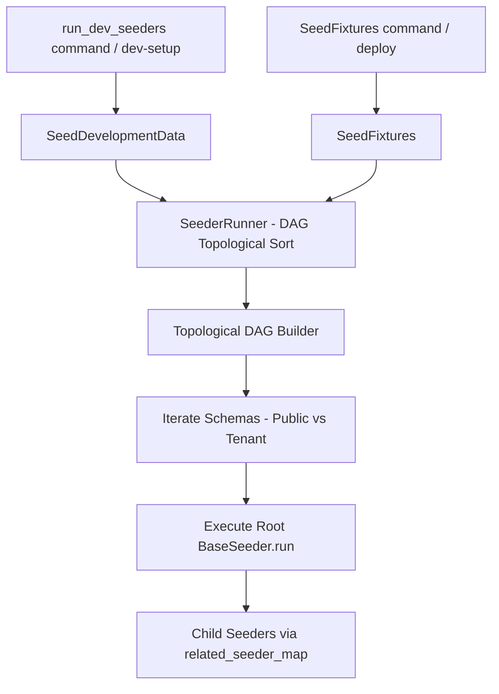

# Analysis: Migrate Seeder Framework from `core/seeder` to `core/libraries/seeder`

**Feature Slug:** `migrate-seeder-to-libraries`
**Status:** In Review (Phase 1 Analysis)
**Date:** 2026-11-22

---

## 1. Executive Summary & Context

The goal is to migrate the database seeder framework from the legacy `core/seeder` module to `core/libraries/seeder`.
The new architecture shifts from an inheritance-based, monolithic `BaseMeta` model to a modular, strategy-and-composition model:
- Persistence strategies are encapsulated in pluggable `Method` objects (`GetorCreateObject`, `UpdateOrCreateObject`, `CreateObject`).
- Data extraction is encapsulated in pluggable `Loader` objects (`FileBasedLoader`, `FactoryBasedLoader`).
- Nested relationships are declared natively via `related_seeder_map` with specialized relation descriptors (`ForwardSingularRelation`, `ReverseSingularRelation`, `ManagerRelation`).
- Custom field transformations are handled via explicit hooks on the seeder (`get_<field_name>(self, raw_value)`).

### Core Architectural Principle: Library Decoupling
As specified by the user:
- **`core/libraries/` must be self-contained and reusable across different apps.**
- **`core/libraries/` must be completely decoupled from apps** (zero imports from `core.apps.*`).
- Seeders in domain apps (`core.apps.*.fixtures`) and setup routines (`core.setup.*`) will import and configure the library classes.

---

## 2. Code Review & Critique of Current WIP `core/libraries/seeder/`

Multi-agent review identified **31 distinct issues**, including 13 critical runtime crashes and severe multi-tenant data corruption bugs in the existing WIP files:

### A. Critical Runtime Crashes
1. **`exceptions.py:18-23`**: `SeederException.__init__` returns a formatted string instead of `None`, causing `TypeError: __init__() should return None, not 'str'`.
2. **`fields.py:106, 187`**: `self.data.keys()[0]` crashes with `TypeError: 'dict_keys' object is not subscriptable` in Python 3.
3. **`methods/base.py:100` & `methods/defaults.py:39`**: `@lru_cache` applied to `split_fields(prepared_fields, seeder)` where `prepared_fields` is a `list`, causing `TypeError: unhashable type: 'list'`.
4. **`methods/base.py:107`**: `self.related_fields.append[field]` uses square brackets instead of `()` (`TypeError: 'builtin_function_or_method' object is not subscriptable`).
5. **`methods/defaults.py:31, 114`**: `fields = list(self.lookup_fields).extend(self.default_fields)`. In Python, `list.extend()` returns `None`, setting `self.fields = None` and causing `TypeError` on subsequent field checks.
6. **`fields.py:24`**: `self.field.clean(self.data)` called with 1 argument; Django's `Field.clean` requires `(value, model_instance)`. Furthermore, reverse relations (`ManyToOneRel`, `ManyToManyRel`) do not possess a `clean()` method (`AttributeError`).
7. **`fields.py:137`**: `_constraint_requires_field` lacks `self` or `@staticmethod`, causing argument count mismatch when called.
8. **`methods/base.py:169`**: `self.perform_seed()` called with 0 arguments; the definition requires `(prepared_fields, seeder)`.
9. **`seeder.py:31`**: `self.label` accessed when only declared under `typing.TYPE_CHECKING`, raising `AttributeError` on any seeder without an explicit `label`.
10. **`seeder.py:51`**: `for item in data:` when `data` is a `dict` iterates over string keys rather than record dictionaries.
11. **`fields.py:56-61`**: `RelationField.__init__` does not accept kwargs (`field_name`, `model`, `data`) passed by `_create_field`.
12. **`methods/defaults.py:116-120`**: `UpdateOrCreateObject.__init__` calls `super().__init__(model, related_seeder_map, fields=fields)`, violating `GetorCreateObject.__init__` signature.
13. **`loaders/static.py:26`**: `load_files` returns `None` on missing directories, causing `for file in ...` in `load_from_dir` to crash with `TypeError: 'NoneType' object is not iterable`.

### B. Severe Multi-Tenancy & Integrity Bugs
14. **Catastrophic Cross-Tenant Leak via Nested Seeders (`seeder.py:47` & `fields.py:111`)**: `BaseSeeder.run()` loops over all tenant schemas. When a parent seeder (e.g., `CustomerSeeder`) running in `Tenant_A` encounters a related field and calls `CustomSeeder().run(self.data)`, the child seeder runs its own loop over **all schemas**, attempting to create records in `Tenant_B` with foreign keys pointing to `Tenant_A`!
15. **Unfiltered SQL UPDATE in `UpdateObject` (`methods/defaults.py:137`)**: Calls `self.model.objects.update(**create_kwargs)` without a `WHERE` clause, overwriting the entire table.
16. **Broken Relation Linking (`fields.py:109-112, 231`)**: `create_related_instance` never sets `self.related_instance`, and `run()` returns `None`. `ManagerRelation.add(self.related_instance)` attempts to add `None`.
17. **Broken `$ref` Resolution (`fields.py:96-99`)**: Unpacks `{"$ref": ...}` into `.get(**lookup_map)`, executing `.get($ref=...)` and raising `FieldError`.
18. **Double Execution (`methods/base.py:116, 132`)**: `split_fields` is called in both `run_full_clean` and `perform_seed`, triggering `create_related_instance` twice and creating duplicate child records.

---

## 3. Architecture Decisions & User Alignment (Confirmed)

The architectural decisions have been aligned with the user:

### 1. Separation of Responsibilities: Schema Orchestration (Runner vs Seeder) - CONFIRMED
- **Decision:** All schema-fetching logic (`Tenant.objects` queries) and schema-switching (`core_schema_context`) are moved completely to the **Runner** (`SeederRunner`).
- **Isolation:** The Runner discovers the target schemas and delegates **one fresh seeder instance per schema context**.
- **Child Isolation:** Child seeders invoked via `related_seeder_map` execute within the currently active schema context of the parent without re-querying or switching tenant schemas. This completely eliminates cross-tenant data leaks.

### 2. Removal of `UpdateObject` - CONFIRMED
- **Decision:** `UpdateObject` has been removed. Plain `CreateObject`, `GetorCreateObject`, and `UpdateOrCreateObject` provide the required persistence strategies.

### 3. `$ref` Handling - CONFIRMED
- **Decision:** Fix `$ref` resolution in `RelationField`. When payload contains `{"$ref": {"attr": "value", ...}}`, the lookup dictionary is extracted directly from the `$ref` key to perform `RelatedModel.objects.get(**lookup)`.

### 4. Resolution of Double Execution (`run_full_clean` vs `perform_seed`) & `lru_cache`
- **Why `lru_cache` failed:**
  1. `prepared_fields` was passed as a `list[SeederField]`. In Python, lists are unhashable, which caused `@lru_cache` to fail immediately with `TypeError: unhashable type: 'list'`.
  2. `split_fields` was mutating instance state (`self.related_fields = [...]`). Caching a function that modifies internal object state means cache hits would skip populating `self.related_fields`.
  3. `field.get_value(seeder)` inside `split_fields` was triggering `create_related_instance(None)`. When `split_fields` was called inside `run_full_clean`, it was executing database creation during validation, and then again during `perform_seed`.
- **The Clean Solution:**
  - Decouple validation from side-effecting persistence:
    - In `run_full_clean`, validate model fields (using dummy/probe data or field validation without instantiating related DB records).
    - In `perform_seed`, resolve values, persist the primary instance via the chosen method, and link relations cleanly.
  - Remove `@lru_cache` from `split_fields`.

### 5. Registry & Discovery
- Retain the proven `__init_subclass__` auto-registration pattern:
  - `BaseSeeder` subclasses register into `seeder_registry` (and `fixture_registry` if `is_fixture=True`).
  - Standalone/root seeders have `is_root = True` (default); nested-only child seeders can declare `is_root = False` to prevent standalone execution by the Runner.

---

## 4. Runner Architecture (`core/libraries/seeder/runner.py`)

The runner architecture will be migrated from `core/seeder/runners.py` to `core/libraries/seeder/runner.py`:

### Components to Implement in `runner.py`:
1. **`SeederRunner(InstanceDAGBuilder)`**:
   - Accepts a `seeder_registry` (or list of seeders).
   - Resolves dependencies (`depends_on = [DevUserSeeder, ...]`).
   - Executes topologically ordered seeders within the appropriate schema context (`core_schema_context`).
   - Wraps individual seeder operations in `transaction.atomic()`.
2. **`SeedDevelopmentData(SeederRunner)`**:
   - Guards against execution in production (`is_production()`).
   - Targets `seeder_registry`.
3. **`SeedFixtures(SeederRunner)`**:
   - Targets `fixture_registry` (production fixtures only).

---

## 5. Seeders Migration Inventory

Every existing seeder in the repository will be migrated to the new class-attribute architecture:

| Seeder Class | File | Type | Target Model | Changes Required |
| :--- | :--- | :--- | :--- | :--- |
| `ConfigurationSeeder` | `core/apps/configurations/fixtures/seeders.py` | Fixture (Public) | `Configuration` | `method = SetConfigMethod(...)`, `loader = FileBasedLoader(...)`, `is_fixture=True`, `schema_name="public"` |
| `CustomerPreferenceTypeSeeder` | `core/apps/crm/fixtures/seeder.py` | Fixture (Org) | `CustomerPreferenceType` | `method = GetorCreateObject(...)`, `loader = FileBasedLoader(...)`, `is_fixture=True` |
| `TenantConfigurationSeeder` | `core/apps/tenants/fixtures/seeder.py` | Fixture (Public) | `TenantConfiguration` | `method = GetorCreateObject(...)`, `loader = FileBasedLoader(...)`, `is_fixture=True`, `schema_name="public"` |
| `DevUsersTemplateLabelSeeder` | `core/setup/configurations/seeders.py` | Dev Seeder | `Configuration` | Inherits `ConfigurationSeeder`, sets `is_fixture=False` |
| `DevCustomerSeeder` | `core/setup/crm/seeder.py` | Dev Seeder | `Customer` | `method = GetorCreateObject(..., related_seeder_map={...})`, coordinates phones/emails/addresses |
| `DevCustomerPhoneSeeder` | `core/setup/crm/seeder.py` | Child Seeder | `CustomerPhone` | `method = CreateObject(...)`, `is_root=False` |
| `DevCustomerEmailSeeder` | `core/setup/crm/seeder.py` | Child Seeder | `CustomerEmail` | `method = CreateObject(...)`, `is_root=False` |
| `DevCustomerAddressSeeder` | `core/setup/crm/seeder.py` | Child Seeder | `CustomerAddress` | `method = CreateObject(...)`, `is_root=False` |
| `DevUserSeeder` | `core/setup/users/seeders.py` | Dev Seeder | `User` | `method = UserCreationMethod(...)` (handles user vs superuser hashing) |
| `DevBillingOrganizationSeeder` | `core/setup/invoices/seeder.py` | Dev Seeder | `BillingOrganization` | `method = GetorCreateObject(...)`, coordinates org emails/phones |
| `DevOrganizationEmailSeeder` | `core/setup/invoices/seeder.py` | Child Seeder | `OrganizationEmail` | `method = CreateObject(...)`, `is_root=False` |
| `DevOrganizationPhoneSeeder` | `core/setup/invoices/seeder.py` | Child Seeder | `OrganizationPhone` | `method = CreateObject(...)`, `is_root=False` |
| `DevInvoicePartySeeder` | `core/setup/invoices/seeder.py` | Dev Seeder | `InvoiceParty` | `method = GetorCreateObject(...)`, coordinates party emails/phones |
| `DevInvoicePartyEmailSeeder` | `core/setup/invoices/seeder.py` | Child Seeder | `InvoicePartyEmail` | `method = CreateObject(...)`, `is_root=False` |
| `DevInvoicePartyPhoneSeeder` | `core/setup/invoices/seeder.py` | Child Seeder | `InvoicePartyPhone` | `method = CreateObject(...)`, `is_root=False` |
| `DevInvoiceItemSeeder` | `core/setup/invoices/seeder.py` | Dev Seeder | `InvoiceItem` | `method = GetorCreateObject(...)` |

---

## 6. Skill Update Plan (`.agents/skills/add-seeder/SKILL.md`)

The skill will be completely updated to teach AI agents how to author seeders using the new pattern:
1. **Core Concept:** Explain Loaders, Methods, and BaseSeeder class-attribute composition.
2. **Template Walkthrough:** Provide standardized templates for:
   - Root Dev Seeder with `FileBasedLoader` and `GetorCreateObject`.
   - Nested Child Seeder linked via `related_seeder_map`.
   - Production Fixture with `is_fixture = True` and public schema targeting.
   - Custom persistence strategies (subclassing `BaseObjectMethods` or `GetorCreateObject`).
3. **Lookup vs Default Fields:** Clear guidelines on separating immutable search keys (`lookup_fields`) from mutable payload keys (`default_fields`).
4. **Field Customization:** Document `get_<field_name>(self, raw_value)` hooks and `$ref` object linking.
5. **Rules & Anti-Patterns:** Update hard rules (never import concrete models, always use getters, no direct DB mocks).

---

## 7. Staged Implementation Plan (Upon Approval)

- **Stage 1 (Core Library Fixes):**
  - Fix all 13 critical bugs and logic flaws in `exceptions.py`, `fields.py`, `methods/`, `loaders/`, and `seeder.py`.
  - Ensure `core/libraries/seeder` has zero dependencies on `core.apps.*`.
- **Stage 2 (Runner Implementation):**
  - Implement `runner.py` with `SeederRunner`, `SeedDevelopmentData`, and `SeedFixtures`.
  - Wire DAG topological dependency resolution and schema-context switching.
- **Stage 3 (Seeder Migration):**
  - Migrate all production fixtures in `core/apps/*/fixtures/`.
  - Migrate all development seeders in `core/setup/*/`.
  - Update `core/apps/configurations/management/commands/run_dev_seeders.py`.
- **Stage 4 (Testing & Verification):**
  - Add comprehensive unit tests in `core/tests/libraries/test_seeder.py` (and migrate `core/tests/seeder/`).
  - Run `make t TEST_DIR=...` to ensure all tests pass.
  - Run `poetry run pre-commit run --all-files` to ensure clean linting and formatting.
- **Stage 5 (Skill & Documentation):**
  - Rewrite `.agents/skills/add-seeder/SKILL.md`.
  - Clean up deprecated `core/seeder` once fully superseded.
